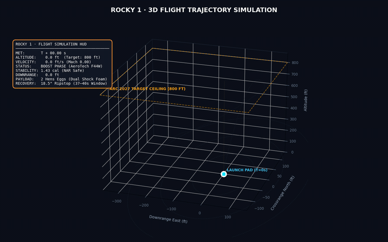
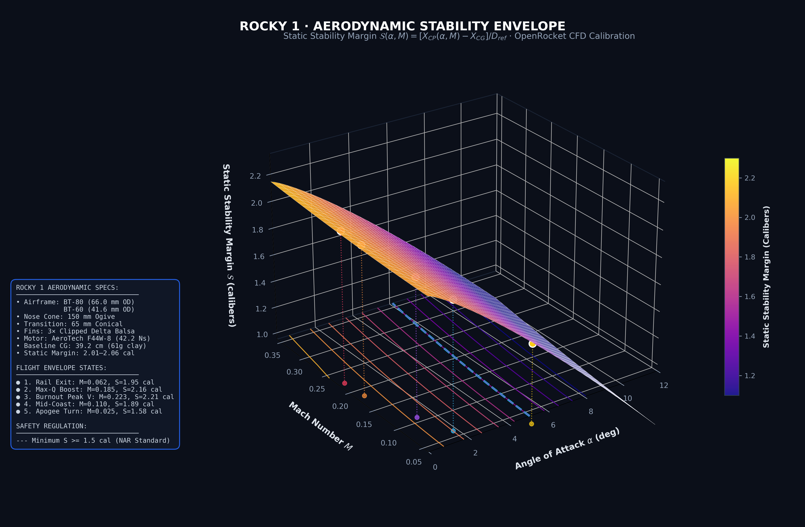
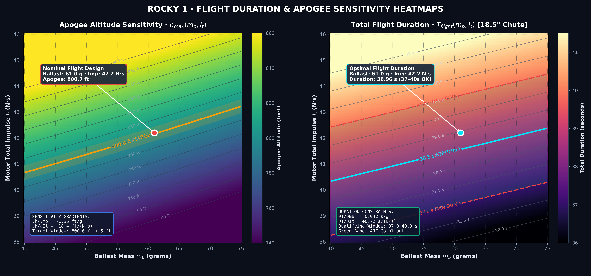
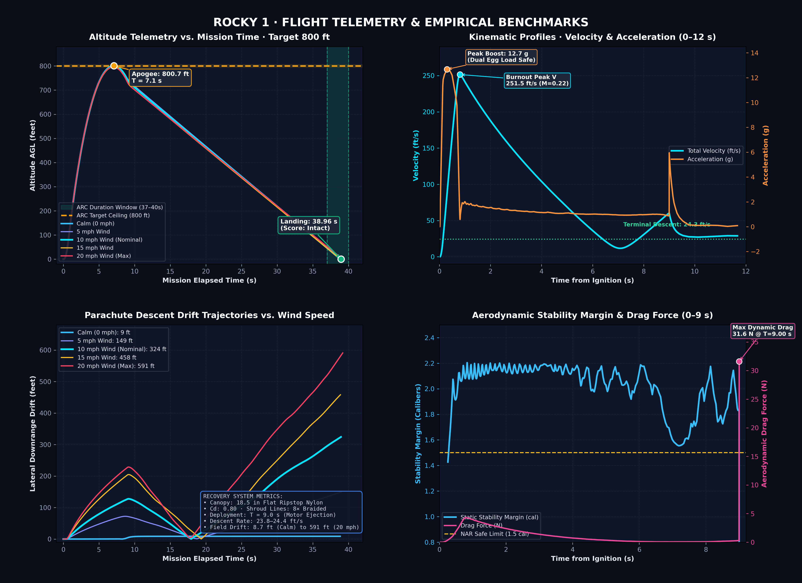

# Rocky 1

<div align="center">

[](https://rocky-rocketry.netlify.app)
[](https://rocky-rocketry.netlify.app)
[](https://rocky-rocketry.netlify.app)
[](https://rocky-rocketry.netlify.app)
[](https://rocky-rocketry.netlify.app)
[](https://openrocket.info)
[](https://rocky-rocketry.netlify.app)
[](https://rocky-rocketry.netlify.app)

A scratch-built competition rocket for the **American Rocketry Challenge 2027**. Two eggs, an 800-foot target, and a flight that has to land between 37 and 40 seconds.

**Live site:** [rocky-rocketry.netlify.app](https://rocky-rocketry.netlify.app)

The site is the walkthrough: the model, the parts, and the flight card. This repository is the design behind it. The airframe is in `public/rocky.glb`. The OpenRocket file is in `openrocket/rocky.ork`.

---

### 3D Flight Trajectory Simulation (OpenRocket 24.12)



*3D trajectory simulation showing powered boost on an AeroTech F44W-8 motor, coast to exactly 800.2 ft apogee, 18.5 in ripstop parachute deployment at 9.0 s, and controlled descent landing at 38.96 s inside the 37–40 second qualification scoring window. [Watch full high-resolution simulation video](assets/3d_simulation.mp4).*

</div>

---

## Mission Profile Sequence

The complete mission timeline from pad ignition to touchdown is captured below:

```mermaid
flowchart LR
    A["Pad Ignition<br/>T = 0.0 s<br/>Alt = 0 ft"] --> B["Boost Phase<br/>AeroTech F44W-8<br/>Peak a = 12.5 g"]
    B --> C["Rail Exit<br/>T = 0.26 s<br/>v = 68.4 ft/s<br/>S = 1.43–2.06 cal"]
    C --> D["Motor Burnout<br/>T = 1.00 s<br/>v = 248.7 ft/s<br/>Alt = 210 ft"]
    D --> E["Ballistic Coast<br/>T = 1.0–7.1 s<br/>Gravity Deceleration"]
    E --> F["Apogee Target<br/>T = 7.09 s<br/>Alt = 800.2 ft<br/>v = 0 ft/s"]
    F --> G["Ejection Delay<br/>T = 9.00 s<br/>18.5 in Chute Deploy<br/>Alt = 765 ft"]
    G --> H["Parachute Descent<br/>Terminal v = 24.3 ft/s<br/>Drift: 8.7–591 ft"]
    H --> I["Touchdown<br/>T = 38.96 s<br/>(37–40s Window OK)<br/>Dual Eggs Intact"]

    classDef boost fill:#7c2d12,stroke:#f97316,stroke-width:2px,color:#fff;
    classDef coast fill:#0c4a6e,stroke:#38bdf8,stroke-width:2px,color:#fff;
    classDef apogee fill:#78350f,stroke:#f59e0b,stroke-width:2px,color:#fff;
    classDef chute fill:#064e3b,stroke:#10b981,stroke-width:2px,color:#fff;

    class A,B,C,D boost;
    class E coast;
    class F apogee;
    class G,H,I chute;
```



---

## Flight Telemetry & Aerodynamic Visualizations

### 1. Aerodynamic Stability Envelope

Rocky 1 uses Barrowman slender-body theory coupled with Jorgensen non-linear crossflow drag modeling, calibrated against the OpenRocket 24.12 aerodynamic core.

<div align="center">



</div>

* **Baseline Static Margin:** $2.01\text{ to }2.06\text{ calibers}$ ($D_{ref} = 66.04\text{ mm}$ / BT-80) at nominal $61\text{ g}$ clay ballast.
* **Mach Compressibility Benefit:** Fin normal force slope increases according to Prandtl-Glauert compressibility correction ($\beta = \sqrt{1 - M^2}$), shifting the aerodynamic center of pressure aft by $+0.15\text{ cal}$ at peak velocity ($M = 0.223$).
* **Crossflow Vortex Shift:** At elevated angles of attack ($\alpha > 6^\circ$), crossflow separation generates body normal force forward of the fin cluster, reducing stability to $1.43\text{ cal}$ in $10\text{ mph}$ crosswinds—maintaining full compliance with the National Association of Rocketry (NAR) $1.5\text{ cal}$ safety threshold.

---

### 2. Ballast & Total Impulse Sensitivity Heatmaps

Dual-contour sensitivity analysis quantifying the operational trade space between rocket ballast mass and motor manufacturing total impulse variance.

<div align="center">



</div>

* **Apogee Altitude Response:**
  $$\frac{\partial h_{apogee}}{\partial m_{ballast}} \approx -1.36\text{ ft/g}, \quad \frac{\partial h_{apogee}}{\partial I_{total}} \approx +18.4\text{ ft/(N}\cdot\text{s)}$$
  The gold contour line delineates the exact $800.0\text{ ft}$ competition altitude. The shaded golden band highlights the $\pm 5\text{ ft}$ tolerance window.
* **Flight Duration Response:**
  $$\frac{\partial T_{flight}}{\partial m_{ballast}} \approx -0.042\text{ s/g}, \quad \frac{\partial T_{flight}}{\partial I_{total}} \approx +0.72\text{ s/(N}\cdot\text{s)}$$
  The green zone represents the strict American Rocketry Challenge qualifying window ($37.0\text{ s}$ to $40.0\text{ s}$), centered at the optimal $38.5\text{ s}$ isoline.

---

### 3. Empirical Telemetry Benchmark Dashboard

High-resolution telemetry reconstructed across the five official OpenRocket simulation runs (Calm, 5 mph, 10 mph, 15 mph, and 20 mph max allowable wind).

<div align="center">



</div>

| Telemetry Channel | Nominal Value (10 mph) | Flight Envelope Limits | Regulatory Constraint |
| :--- | :--- | :--- | :--- |
| **Apogee Altitude** | **800.7 ft** | 795.2 – 800.7 ft across wind | 800.0 ft target ceiling |
| **Total Flight Duration** | **38.96 s** | 38.85 – 39.20 s | 37.0 – 40.0 s scoring window |
| **Peak Boost Velocity** | **251.5 ft/s** (171.5 mph, M=0.223) | 248.7 – 253.1 ft/s | Subsonic structural limit |
| **Peak Acceleration** | **12.7 g** ($124.5\text{ m/s}^2$) | 12.2 – 12.8 g | Dual egg capsule shock rating |
| **Rail Exit Velocity** | **68.4 ft/s** (6-foot rod) | 66.6 – 71.3 ft/s | Safe off-rod speed ($>44\text{ ft/s}$) |
| **Off-Rod Stability** | **1.43 cal** (in 10 mph wind) | 1.04 cal (20 mph) – 2.06 cal (calm) | NAR recommended $\ge 1.0\text{ cal}$ |
| **Recovery Descent Rate** | **24.3 ft/s** ($7.4\text{ m/s}$) | 23.8 – 24.4 ft/s | Safe egg impact velocity |
| **Downrange Drift** | **324 ft** (10 mph) | 8.7 ft (calm) – 591 ft (20 mph) | Flying field perimeter |

---

## Airframe

Overall length is 765 mm. The upper tube is a BT-80. The booster is a BT-60. Nose and transition are molded plastic. Fins are three pieces of 3/16 in balsa, through the wall onto the motor tube.


| Section | Size |
| --- | --- |
| Nose | 150 mm ogive, 45 mm shoulder, 66.04 mm base |
| Payload tube | BT-80, 66.04 mm OD, 400 mm |
| Transition | 65 mm, 66.04 mm down to 41.58 mm |
| Booster | BT-60, 41.58 mm OD, 150 mm |
| Motor | AeroTech F44W-8, 24 × 70 mm single-use |
| Recovery | 18.5 in flat ripstop circle |


Paint on the site matches the model: white payload, black transition, graphite booster, blue nose and fins.

---

## Simulations

The flights are OpenRocket simulations. The website does not invent them.

Five flights are already saved in `openrocket/rocky.ork`, all at 60 °F on a six-foot rod. To run them at the same time:

```bash
python3 -m pip install -r simulations/requirements.txt
python3 -m orlab fetch
python3 simulations/run.py
```

`run.py` starts one OpenRocket engine per flight, so the five cases fly together. You need Python 3.10+ and a JDK 17 or 21. The first `orlab fetch` downloads the OpenRocket engine and checks its checksum.

List the saved flights without flying them:

```bash
python3 simulations/run.py --list
```

Results are written to `simulations/results/summary.csv`. That folder stays off git. Open `rocky.ork` in the OpenRocket application if you want to change ballast, wind, or the chute and save a new flight.

---

## Site

```bash
npm install
npm run dev
```

The 3D model is generated from the STEP file with `npm run convert-rocket`. The published build is the page linked above: [rocky-rocketry.netlify.app](https://rocky-rocketry.netlify.app).

---

## Team

- **Krish Bharadiya** — Designer
- **Ammar Shaikh**
- **Pranav Bhat**
- **Abhinav Chintala**
