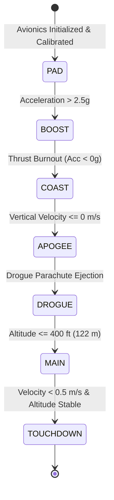

# Architecture Specification: Rocky Flight Physics & Avionics Telemetry Engine

## 1. Executive Summary
`rocky` provides physics simulation, mission planning, and real-time avionics telemetry visualization for the American Rocketry Challenge (TARC). The system combines a 6-Degree-of-Freedom numerical trajectory simulator (Runge-Kutta 4th Order) with a live serial/WebUSB stream decoder for onboard flight computers.

---

## 2. Flight Dynamics & Telemetry Architecture

```mermaid
flowchart TD
    subgraph SimulationEngine["Numerical Flight Simulation Engine (RK4)"]
        MotorFile[".eng / .rse Motor File"] --> ThrustInterp["Thrust Curve Interpolator\nLinear Interpolation & Mass Burnoff"]
        AtmoModel["Atmospheric Model\nUS Standard Atmosphere 1976 (rho, p, T)"] --> DragCalc["Aerodynamic Drag Solver\nF_drag = 0.5 * rho * v^2 * Cd * A"]
        ThrustInterp --> StateDerivative["State Derivatives (dy/dt)\n[v, (F_thrust - F_drag - mg)/m]"]
        DragCalc --> StateDerivative
        StateDerivative --> RK4["Runge-Kutta 4th Order Integrator\n(dt = 0.01s)"]
        RK4 --> Trajectory["Trajectory Time-Series\n(Apogee, Burnout, Drift, Descent Rate)"]
    end

    subgraph AvionicsIngest["Live Avionics Telemetry Pipeline"]
        Altimeter["Flight Altimeter / ESP32\n(Barometer + 3-Axis IMU)"] --> Serial["Web Serial / USB Stream\n(115200 Baud)"]
        Serial --> Reassembler["Sentence Buffer Reassembler\n(NMEA Format: $ROCKY,...)"]
        Reassembler --> CRC["CRC-16-CCITT Checksum Verification"]
        CRC --> Schema["Pydantic TelemetryFrame Validation\n(Range & Physics Checks)"]
        Schema --> FSM["Flight Phase State Machine\n(PAD -> BOOST -> COAST -> APOGEE -> DESCENT -> TOUCHDOWN)"]
        FSM --> Dashboard["Real-time Web UI Dashboard\n(Three.js 3D Replay + Altitude Chart)"]
    end
```



---

## 3. Flight Phase State Machine



---

## 4. Mathematical Specifications

### 4.1 Runge-Kutta 4th-Order (RK4) Numerical Integration
The rocket state vector $\mathbf{y}(t) = [z(t), v(t)]^T$ is integrated forward with step size $\Delta t = 0.01\text{ s}$:
$$\mathbf{y}_{n+1} = \mathbf{y}_n + \frac{\Delta t}{6} \left(\mathbf{k}_1 + 2\mathbf{k}_2 + 2\mathbf{k}_3 + \mathbf{k}_4\right)$$
Where the derivative function $\mathbf{f}(t, \mathbf{y}) = [v, a(t, z, v)]^T$ computes net acceleration:
$$a(t, z, v) = \frac{T(t) - F_{\text{drag}}(z, v)}{m(t)} - g$$

### 4.2 Atmospheric Density & Aerodynamic Drag
1. **Lapse Rate Model** (Troposphere $z < 11{,}000\text{ m}$):
   $$T(z) = T_0 + L \cdot z, \quad p(z) = p_0 \cdot \left(1 + \frac{L \cdot z}{T_0}\right)^{-\frac{g M}{R L}}$$
   $$\rho(z) = \frac{p(z) \cdot M}{R \cdot T(z)}$$
2. **Quadratic Aerodynamic Drag**:
   $$F_{\text{drag}} = \frac{1}{2} \rho(z) v^2 C_d A$$

### 4.3 Telemetry Protocol & Sentence Syntax
Sentences arrive via serial UART stream in standardized format:
```text
$ROCKY,seq,timestamp_ms,pressure_hpa,alt_m,acc_x,acc_y,acc_z,vbat_v,temp_c*CRC16\r\n
```
* **CRC16**: CCITT polynomial $0x1021$ with initial value $0xFFFF$ computed over all bytes between `$` and `*`.
* **Sensor Validation**: Frames with non-finite values or unphysical descent velocities ($> 50\text{ m/s}$) are flagged for rejection.

---

## 5. Verification & Testing Guardrails
* **Pytest Test Suite**: `simulations/test_rk4_physics.py`, `simulations/test_telemetry_decoder.py`, `simulations/test_telemetry_schema.py`.
* **Coverage**: 15 tests verifying thrust curve parsing, total impulse integrals, packet reassembly, and flight phase sequencing.
